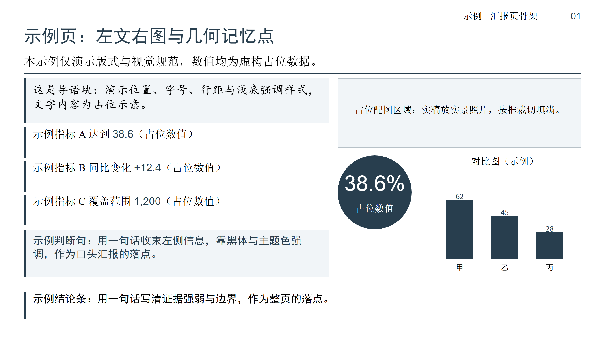
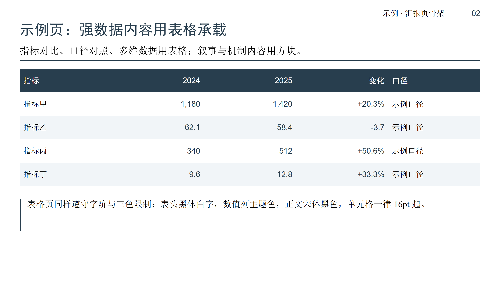

# 汇报 PPT 规范（ppt-report-style）

一套中文汇报 PPT 的排版规范 + 可执行的工作流。让 AI 生成的 PPT 在**字体、配色、版式骨架、图表与方块取舍、逐字稿**上稳定达标，而不是每次都返工。

<p align="center">
  
</p>

<p align="center">
  
</p>

> 示例页为纯占位内容（虚构数据），用于展示版式，不含任何真实项目材料。

## 解决什么问题

- 字体分两槽：**中文只用宋体/楷体/黑体**（`a:ea`），**西文只用 Arial / Times New Roman**（`a:latin`）——英文不再借用中文字体的西文字形。文字只有**黑 / 白 / 主题色**三色（默认 `#283E4E`）。
- **六档字阶**：`16 / 18 / 20 / 30 / 36 / 44`，内容对号入座（正文 18、副标与导语 20、页面标题 30、封面 44、表格与图注 16、大数字 36–44）；一页最多 5 档，黑体不叠加粗体。
- **强数据、强主题 → 表格**；叙事、机制、并列要点 → **方块/方格**，块内直接写内容，不加"关键指标"这类小标题。
- 指标名与数值写在**同一句**里，不做两层结构。
- 统一页面骨架：页眉 16pt → 30pt 命题式标题 → 20pt 副标 → 细线 → 左文右图双栏 → 底部 18pt 结论条（坐标见 `references/workflow.md`）。
- 每页一个**几何记忆点**（圆 / 三角 / 环形图 / 圆点线路 / 六边形…），同批页面各不相同但骨架一致。
- 每页备注写入**约 1 分钟逐字稿**，数据来源与口径只放备注不上片。
- 交付前**四道自检**：结构审查（越界/溢出/西文不可断行/表格撑高）→ 样式校验（字阶、三色、双槽字体）→ HTML 预览图人眼检查 → 数字回溯原材料。

## 安装

**方式一：skill-installer（Codex 内）**

```
$skill-installer install https://github.com/xiongxq04/ppt-report-style/tree/main/skills/ppt-report-style
```

**方式二：手动**

```bash
git clone https://github.com/xiongxq04/ppt-report-style.git
cp -r ppt-report-style/skills/ppt-report-style ~/.codex/skills/
```

安装后重启 Codex 即可被识别。

## 使用

安装后无需显式点名。说"按我的规范做 PPT""把这个 PPT 重新排版""给这页配图表和逐字稿"等需求时会自动启用；也可显式写：

```
$ppt-report-style 帮我做一套关于××的汇报 PPT，10 页
```

## 脚本

| 脚本 | 用途 |
| --- | --- |
| `scripts/verify_ppt_style.py` | 校验字号下限与**字阶档位**、三色、中文字体（`a:ea`）与西文字体（`a:latin`）双白名单、黑体加粗、楷体入表格（含表格与图表内文字） |
| `scripts/audit_ppt.py` | 结构审查：越界、文本溢出、**西文不可断行**、**表格单元格撑高**、元素重叠、字体槽、字形缺失、全角西文、备注缺失、表宽 |
| `scripts/preview_ppt.py` | 把 pptx 渲染成 HTML 预览（形状、表格、柱/条/环/散点图近似渲染） |
| `scripts/build_example.py` | 重新生成 `assets/example-slide.pptx` 中性示例页 |

```bash
python3 -m pip install python-pptx
python scripts/verify_ppt_style.py 你的.pptx
python scripts/verify_ppt_style.py 你的.pptx --accent 1F4E79 --min-size 18
python scripts/audit_ppt.py 你的.pptx
python scripts/preview_ppt.py 你的.pptx out.html --slide 0
```

预览图需要 Playwright + Chrome 截图；没有浏览器时把 HTML 直接打开即可。

## 可配置项

| 项 | 默认 | 改法 |
| --- | --- | --- |
| 主题色 | `#283E4E` | 生成脚本换常量；校验用 `--accent` |
| 最小字号 | 16pt | 校验用 `--min-size` |
| 字阶档位 | 16,18,20,30,36,44 | `verify_ppt_style.py --sizes "16,18,20,28"`；每页档数 `--max-steps` |
| 中文字体白名单（`a:ea`） | 宋体,楷体,黑体 | 校验用 `--fonts "宋体,黑体"` |
| 西文字体白名单（`a:latin`） | Arial,Times New Roman | 校验用 `--latin-fonts "Arial"`；不要往这里加中文字体 |
| 额外允许色 | 无 | 校验用 `--allow-colors` |

系统缺少宋体/楷体时，AI 会先询问是否接受替代字体，不会静默替换。

## 目录结构

```
ppt-report-style/
├── .codex-plugin/plugin.json     # Codex skill-only plugin 清单
├── LICENSE
├── README.md
└── skills/ppt-report-style/
    ├── SKILL.md                   # 硬性规范（加载即生效）
    ├── LICENSE.txt
    ├── agents/openai.yaml
    ├── assets/                    # 中性示例页与预览图
    ├── references/
    │   ├── workflow.md            # 六阶段工作流与返工触发条件
    │   └── eval-queries.json      # 20 条触发测试用例
    └── scripts/                   # 校验 / 预览 / 示例生成
```

## FAQ

- **字体不全怎么办**：确认后可在 `--fonts` 里加入替代字体名。
- **英文为什么单独一槽**：python-pptx 的 `run.font.name` 只写 `a:latin`，中文字形取 `a:ea`。只设中文字体名会让英文用中文字体的西文字形渲染（字距松、字形丑）；两槽分开设置后，英文走 Arial / Times New Roman。跑历史文件可加 `--allow-cjk-latin` 暂时放行。
- **图表预览与 PowerPoint 有差异**：预览是近似渲染，用于查溢出与对齐，最终以 PowerPoint 为准。
- **想改整页骨架**：`references/workflow.md` 里写了每段的坐标与间距基准。

## 许可证

MIT，见 [LICENSE](LICENSE)。

## 参考

- [Agent Skills 开放规范](https://agentskills.io)
- [Codex 插件与技能文档](https://developers.openai.com/codex/plugins/build)

## English

A style guide + executable workflow for **Chinese-language reporting decks**. It tells the agent how to lay out a slide so the result is consistent instead of something you have to re-lay out every time.

- Typography uses **two slots**: Chinese in SimSun / KaiTi / HeiTi (`a:ea`), Latin in **Arial or Times New Roman** (`a:latin`) — English never borrows a CJK font's Latin glyphs. Text colours are limited to black, white and one accent colour (`#283E4E` by default).
- A **six-step type scale**: `16 / 18 / 20 / 30 / 36 / 44` pt, mapped by role (body 18, subtitle & lead 20, slide title 30, cover 44, tables & captions 16, big numbers 36–44); at most five steps per slide; HeiTi is never synthesised-bold.
- Pick the container by content: **tables for dense, data-heavy material**; **boxes/grids for narrative, mechanisms and parallel points** — and never put a mini-heading like "Key metrics" inside a box.
- Metric name and value belong in the **same sentence**.
- Fixed page skeleton: header 16pt → 30pt declarative title → 20pt subtitle → rule → two-column body → bottom 18pt takeaway bar.
- One **geometric motif per slide** (circle, triangle, donut, dotted route, hexagon…) — different on every page of a deck, while the skeleton stays identical.
- ~1 minute of speaker notes per slide; sources and caveats live in the notes, never on the slide.
- Four checks before delivery: structural audit (overflow, unbreakable Latin tokens, table cells pushing taller) → style validation (type scale, palette, both font slots) → rendered preview → trace every number back to the source material.

**Install**

```bash
$skill-installer install https://github.com/xiongxq04/ppt-report-style/tree/main/skills/ppt-report-style
```

**Scripts**: `verify_ppt_style.py` (type scale / palette / CJK + Latin font slots), `audit_ppt.py` (structure audit), `preview_ppt.py` (pptx → HTML preview), `build_example.py` (regenerate the neutral example deck).

MIT licensed.
