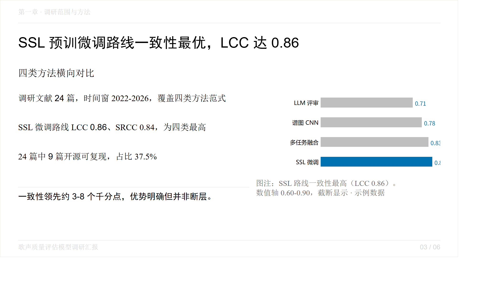
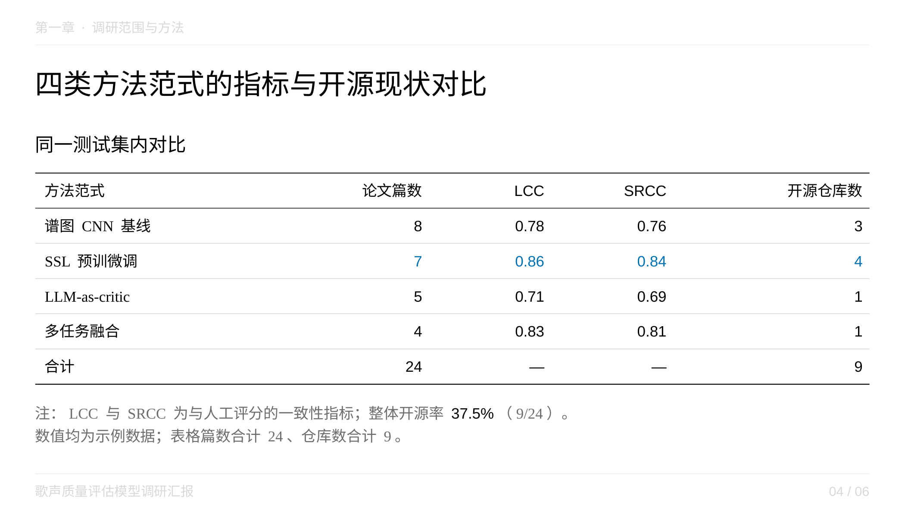

# 汇报 PPT 规范（ppt-report-style）

一套中文汇报 PPT 的排版规范 + 可执行的工作流。让 AI 生成的 PPT 在**字体、配色、版式骨架、配图、逐字稿**上稳定达标，而不是每次都返工。v0.4 起采用**三档严格度 × 配色预设**的可调节架构：草稿、组会、答辩各取所需，一套脚本全家通用。

<p align="center">
  
</p>

<p align="center">
  
</p>

> 示例页为纯占位内容（虚构数据），用于展示版式，不含任何真实项目材料。

## 解决什么问题

- **档位化**：`fast`（内部草稿，一切放宽）/ `balanced`（默认，常规汇报）/ `strict`（答辩/投稿，个人学术规范全文生效）。字号下限、大数字、前缀、装饰预算、骨架重复、备注下限全部随档位分治，机审按档位执法。
- **配色成套**：四套色盲安全预设——`A` Okabe-Ito 学术蓝（默认）、`B` 深青蓝、`C` 砖红、`D` 青绿循环（深蓝锚点+暖色系列）。每套是完整 token 角色表（墨/次级灰/发丝线/图表灰/点缀/点缀深/序列色），文字 token 全部 ≥4.5:1 且机审强制；换预设用 `--preset` 一键整套换。另有外部色板库 `palette-library.md`（7 组实算对比度）作为新预设与自定义序列色的选材来源。
- **字体分两槽**：中文只用宋体/楷体/黑体/微软雅黑（`a:ea`），西文只用 Arial / Times New Roman（`a:latin`）——英文不再借用中文字体的西文字形。
- **七档字阶**：`14(HF 页眉页脚档) / 16 / 18 / 20 / 30 / 36 / 44`，一页最多 5 档；正文硬下限 16pt，14pt 仅限页眉页脚极浅灰且仅在页眉/页脚几何区（机审按位置豁免，染灰正文照查）。
- **先判断内容关系，再选骨架**：关系模型库（并列/对比/流程/因果/层级/循环/辐射/矩阵/递进/演变/空间/时间线）+ 六种页面骨架；骨架重复检查按档位分治（strict 的统一骨架是美德，不是错误）。
- **点缀色纪律**：每页限额按形状计（strict ≤2 / balanced ≤3）；图表只点亮一处（`PAL.CHART_SERIES`）；关键数字句内黑体强调，strict 档不做大数字 callout。
- **截断轴诚实条款**：数值轴截断窗口必须在图注明写，结论句写真实量级——不许制造断层假象，也不许假装没截断。
- **配图分三档必要性**：必须实景 / 建议配图 / 可用图表替代；按放置尺寸判分辨率（<96dpi 报错，<150dpi 警告，`IMG.RES` 机审）。
- 每页备注写入约 1 分钟逐字稿（档位决定字数下限），数据来源与口径只放备注不上片。
- 交付前**统一检查入口**按错误/警告/建议/例外汇总；附含正例（三档 × 三预设全绿）与反例（必须命中 18 条预期规则）的**回归测试**。
- **不使用 SmartArt**；源文件已有 SmartArt 保持原状并用 `--allow-smartart` 声明。

## 安装

**方式一：skill-installer（Codex 内）**

```
$skill-installer install https://github.com/xiongxq04/ppt-report-style/tree/main/skills/ppt-report-style
```

**方式二：手动**

```bash
git clone https://github.com/xiongxq04/ppt-report-style.git
cp -r ppt-report-style/skills/ppt-report-style ~/.codex/skills/
```

安装后重启 Codex 即可被识别。

## 使用

安装后无需显式点名。说"按我的规范做 PPT""用答辩模式重排""把这个 PPT 重新排版"等需求时会自动启用；也可显式写：

```
$ppt-report-style 帮我做一套关于××的汇报 PPT，10 页，strict 档、配色用学术蓝
```

新建整套演示前，它会先定档位与配色预设、给一页纸大纲确认后再生成。

## 阈值真相源

所有阈值集中在 **`skills/ppt-report-style/references/profiles.json`**（三档 × 四预设）：字号下限、字阶、白名单、限额、备注下限、骨架规则。文档只引用不重定义，脚本经 `profile_lib.py` 读取——改一处，全仓生效。

## 脚本

| 脚本 | 用途 |
| --- | --- |
| `scripts/check_ppt.py` | 统一检查入口：调度下面两个检查脚本，按**错误 / 警告 / 建议 / 例外**分级汇总，支持 `--tier`、`--preset`、`--json`、`--layout-report` |
| `scripts/verify_ppt_style.py` | 字阶档位、预设 token 配色与对比度、点缀每页限额、图表点亮数、双字体槽、黑体加粗、楷体入表格、前缀与口径（TYP./PAL./FONT. 规则） |
| `scripts/audit_ppt.py` | 结构审查：越界、文本溢出、西文不可断行、表格单元格撑高、元素重叠、字体槽、字形缺失、全角西文、备注、阴影与主题特效引用、配图分辨率、布局骨架（GEO./TXT./FONT./EFF./IMG./LAY./NOTE. 规则） |
| `scripts/palette_utils.py` | 预设对比度自检（`--check [--preset B|C|D]`）、对比度计算、自定义色阶派生（`--scale`） |
| `scripts/preview_ppt.py` | pptx → HTML 预览（`--slide N`，0 基；形状、图片、表格、柱/条/环/散点图近似渲染） |
| `scripts/build_example.py` | 生成 6 页学术示例（`--variant academic|negative`，`--preset A|B|C|D`） |
| `scripts/run_regression.py` | 回归基线：正例在 balanced/strict 零错误零警告，全部预设端到端冒烟，反例命中全部预期规则 |

```bash
python3 -m pip install python-pptx
python scripts/palette_utils.py --check
python scripts/check_ppt.py 你的.pptx --tier balanced --preset A
python scripts/check_ppt.py 你的.pptx --tier strict --layout-report
python scripts/preview_ppt.py 你的.pptx out.html --slide 0
python scripts/run_regression.py
```

预览图需要浏览器截图；没有 Playwright 时，把 HTML 直接打开或用 Chrome / Edge 的 headless 截图即可。

## 可配置项

| 项 | 默认 | 改法 |
| --- | --- | --- |
| 档位 | `balanced`（学术/答辩用 `strict`） | `--tier fast|balanced|strict`（旧参数 `--mode balanced\|strict` 等价） |
| 配色预设 | `A`（Okabe-Ito 学术蓝） | `--preset A|B|C|D`；临时换点缀色 `--accent` |
| 最小字号 / 字阶 / 档数 | 取自档位（profiles.json） | `--min-size` `--sizes` `--max-steps` |
| 字体白名单 | 取自档位 | `--fonts` `--latin-fonts`；不要往西文白名单加中文字体 |
| 额外允许色 | 无 | `--allow-colors` |
| 备注最少字数 | 取自档位（strict 150 / balanced 90 / fast 0） | `--notes-min` |
| 例外记录 | 无 | check_ppt `--exceptions exceptions.json`；页面级在备注写 `[例外:规则名]` + 理由 |

系统缺少宋体/楷体时，AI 会先询问是否接受替代字体，不会静默替换。

## 目录结构

```
ppt-report-style/
├── .codex-plugin/plugin.json     # Codex skill-only plugin 清单
├── .github/workflows/validate.yml # CI：三档×预设机审 + 语义重建比对 + 正反例回归
├── CHANGELOG.md
├── LICENSE
└── skills/ppt-report-style/
    ├── SKILL.md                   # 硬性规范（加载即生效；档位与预设架构入口）
    ├── LICENSE.txt
    ├── agents/openai.yaml
    ├── assets/                    # 6 页学术示例与预览图
    ├── references/
    │   ├── profiles.json          # ★ 三档 × 三预设的阈值唯一真相源
    │   ├── workflow.md            # 分阶段工作流与返工触发条件
    │   ├── palette-system.md      # 配色预设与对比度
    │   ├── palette-library.md     # 外部色板库（7 组实算对比度，选材来源）
    │   ├── layout-patterns.md     # 关系模型与页面骨架（骨架重复按档位分治）
    │   ├── visual-means.md        # 视觉手段与纯文字页
    │   ├── effect-budget.md       # 章节母题与效果预算（fast/balanced 适用）
    │   ├── image-sourcing.md      # 配图必要性与素材来源
    │   ├── style-rules.md         # 档位表与形状、结论条规则
    │   ├── template-editing.md    # 模板跟随改版四步
    │   ├── checking.md            # 规则 ID、检查分级、例外协议与交付
    │   └── eval-queries.json      # 30 条触发测试用例
    └── scripts/                   # 检查 / 预览 / 示例生成 / 回归
```

## FAQ

- **档位怎么选**：内部草稿 `fast`；常规组会/项目汇报 `balanced`（默认）；答辩、投稿配套、正式评审 `strict`。
- **字体不全怎么办**：确认后可在 `--fonts` 里加入替代字体名。
- **英文为什么单独一槽**：python-pptx 的 `run.font.name` 只写 `a:latin`，中文字形取 `a:ea`。只设中文字体名会让英文用中文字体的西文字形渲染。跑历史文件可加 `--allow-cjk-latin` 暂时放行。
- **页眉页脚的浅灰为什么可以 14pt**：极浅灰档是刻意退后的辅助信息，且机审按几何位置豁免（页眉区 top+height≤0.7in、页脚区 top≥7.0in）——正文里染浅灰逃逸字号检查行不通。
- **纯文字页会不会被判失败**：封面/章节页（≥36pt 标题）不计入统计；内容页纯文字占比按档位阈值（balanced 30% / strict 60%）。
- **为什么不用 SmartArt**：SmartArt 跨版本打开容易变形且难以精确对齐；一律用普通形状、表格或图表表达。
- **图表预览与 PowerPoint 有差异**：预览是近似渲染，用于查溢出与对齐，最终以 PowerPoint 为准。
- **检查报错太多怎么办**：默认按"同页同规则最多 3 条"折叠（`--max-per-rule`）；合理的连续布局在备注写 `[例外:骨架重复]` 说明理由。

## 版本

v0.4.0（见 `CHANGELOG.md`）：三档 × 三预设架构落地；修复 v0.3→v0.4 过渡期 check_ppt 接口断裂、示例页数断言、D9D9D9 豁免位置盲洞等一致性问题；CI 升级为三档×预设矩阵 + 语义重建比对 + 正反例回归。

## 许可证

MIT，见 [LICENSE](LICENSE)。

## 参考

- [Agent Skills 开放规范](https://agentskills.io)
- [Codex 插件与技能文档](https://developers.openai.com/codex/plugins/build)
- Okabe & Ito, Color Universal Design；Wong, B. (2011). Points of view: Color blindness. *Nature Methods*.

## English

A style guide + executable workflow for **Chinese-language reporting decks**, now with a **three-tier (fast / balanced / strict) × four-preset palette** architecture: draft, seminar and defense decks each get the right strictness, all driven from one machine-readable source of truth (`references/profiles.json`) and enforced by scripts.

- **Typography**: two font slots (Chinese in `a:ea`, Latin in `a:latin` — Arial / Times New Roman); seven-step type scale with a 16pt body floor (14pt reserved for the pale header/footer tier, position-checked).
- **Color**: four colorblind-safe presets (Okabe-Ito blue default, deep teal, brick red, teal-cycle with warm series), each a full role table with WCAG-verified text tokens; per-slide accent budgets machine-enforced; charts light exactly one mark. An external palette library (`palette-library.md`) documents seven measured source palettes for future presets and custom series colors.
- **Honest data**: truncated axes must be declared in the caption; key numbers are emphasized in-sentence, not poster-sized (strict tier).
- **Layout from content relation**: a relation-model library and six skeletons; skeleton-repeat rules are tier-aware.
- **Checks**: unified entry (`check_ppt.py`) triages ERROR / WARNING / SUGGESTION / EXCEPTION with stable rule IDs; a regression suite requires the positive example to be clean on all tiers and presets and a synthetic negative deck to trip every expected rule.
- ~1 minute of speaker notes per slide; sources and caveats live in the notes. **No SmartArt**.

**Install**: `$skill-installer install https://github.com/xiongxq04/ppt-report-style/tree/main/skills/ppt-report-style` — **Scripts**: `check_ppt.py`, `verify_ppt_style.py`, `audit_ppt.py`, `palette_utils.py`, `preview_ppt.py`, `build_example.py`, `run_regression.py`. MIT licensed.
